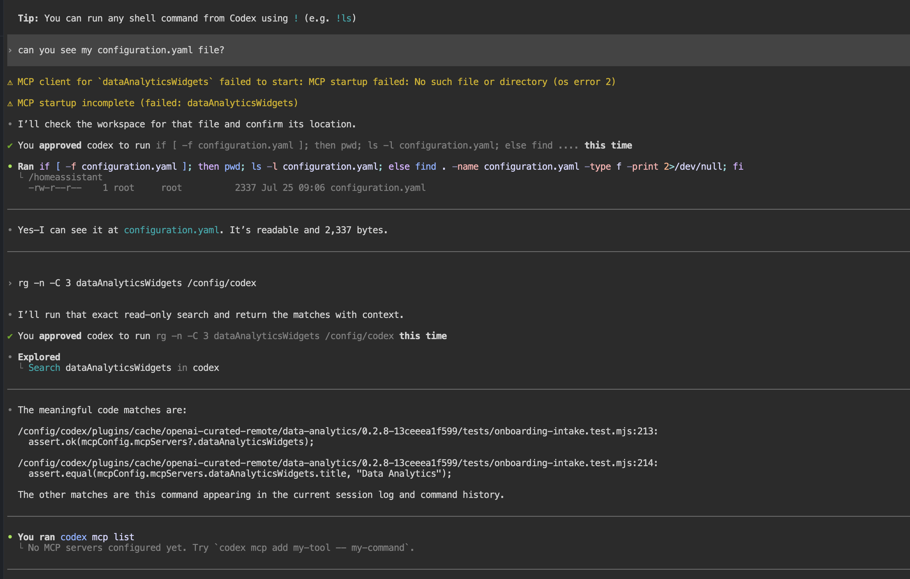

# Codex Habitat

Run OpenAI Codex from your Home Assistant sidebar. Review and edit automations,
dashboards, YAML, and custom components in a persistent terminal.

> **Back up Home Assistant first.** Codex can edit your configuration. Review
> proposed changes before approving them; this is a coding workspace, not Assist.

[](https://my.home-assistant.io/redirect/supervisor_add_addon_repository/?repository_url=https%3A%2F%2Fgithub.com%2Fbruvv%2Fcodex-habitat)
[](https://github.com/bruvv/codex-habitat/releases/latest)

## Start here

1. Add this repository, then install and start **Codex Habitat** from
   **Settings → Apps → App Store**.
2. Enable **Show in sidebar** and open Codex Habitat.
3. Choose **Sign in with Device Code** and complete sign-in on another device.
   An OpenAI API key is a separate, usage-billed alternative.

If the install button does not work, add this repository manually:

```text
https://github.com/bruvv/codex-habitat
```

Try a read-only first prompt:

```text
Review my Home Assistant configuration. Do not edit files or restart anything.
Explain the most important problems first.
```



## Configuration and help

The [user guide](codex_habitat/DOCS.md) covers model selection, every setting,
reloads and restarts, copy/paste, file transfer, and troubleshooting. It is also
available in the add-on's **Documentation** tab.

Reloads and restarts are off by default in the helper. These switches are not
security boundaries for code running inside the container. Keep backups and
protect access to your Home Assistant account.

See the [changelog](codex_habitat/CHANGELOG.md) for release notes and
[CONTRIBUTING.md](CONTRIBUTING.md) before contributing. When reporting a problem,
include the add-on version and exact error, but remove tokens, device codes,
API keys, private URLs, and personal configuration.
